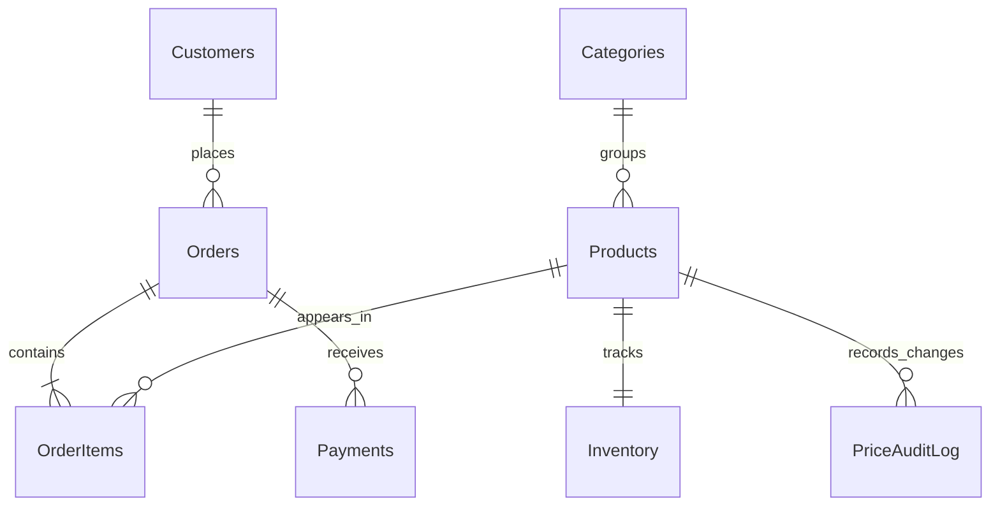

# Order Management & Sales Analytics Database

## Project Overview

This portfolio project models an e-commerce order workflow in SQL Server. It demonstrates relational design, order processing, stock control, payments, sales reporting, and measured query tuning.

**Problem statement:** Build a normalized, referentially valid database that records orders and payments, prevents stock from going negative, supports sales/customer analysis, and provides a repeatable performance comparison on a large synthetic dataset.

## Tech Stack

- Microsoft SQL Server 2017+ and SQL Server Management Studio (SSMS)
- T-SQL: constraints, table-valued parameters, transactions, stored procedures, views, triggers, CTEs, and window functions
- Python 3.10+, Pandas, Faker, and pyodbc
- Streamlit dashboard, Git, and pytest

## Data Model

The tables are designed in 3NF. Order-line price is retained as a transaction snapshot; payments and inventory are separate entities. See [docs/er_diagram.md](docs/er_diagram.md) and [docs/design_decisions.md](docs/design_decisions.md) for details.



## Features

- Eight related tables with primary/foreign keys and named CHECK, UNIQUE, and DEFAULT constraints
- Repeatable Python CSV generation for 5,000 customers, 500 products, 100,000 orders, and at least 300,000 order items
- `usp_PlaceOrder`, `usp_GetCustomerHistory`, and `usp_GetMonthlySalesReport`
- `vw_MonthlySales`, `vw_LowStockProducts`, and `vw_CustomerLifetimeValue`
- Set-based inventory and product-price audit triggers
- CTE/window analytics: top products (`RANK`/`ROW_NUMBER`), running revenue, month-over-month growth (`LAG`), customer segments (`NTILE`), and new/repeat customers
- Three baseline/tuned query scenarios with non-clustered/covering indexes and SARGable rewrites
- Parameterized Streamlit dashboard queries and SQL Server integration tests

## Prerequisites

1. SQL Server 2017+ and SSMS. Your SQL login needs permission to create a database and objects.
2. Python 3.10+ and `pip`.
3. Microsoft ODBC Driver 18 for SQL Server installed on the machine running Python.
4. For `BULK INSERT`, a folder readable by the SQL Server service account. A workstation path may not be visible to SQL Server, especially when SQL Server runs in a container or on another host.

## Setup and Run Order

Run terminal commands from `order-management-sql/`. Execute SQL files in SSMS against the same SQL Server instance.

For a local Docker-based setup, provide a strong local SA password with `MSSQL_SA_PASSWORD` and run `bash scripts/local_setup.sh`. The script starts or reuses the `order-management-sql-db` container, generates the default dataset, and installs the schema and database objects using port 1433 and the SQL Server command-line tool included in the container image. The container is configured to restart unless manually stopped; the dashboard verifies a fresh SQL connection on each rerun and retries transient network failures. **The setup script drops and recreates the `OrderManagementSalesAnalytics` database each time; back up any data you need before running it.** Keep the password out of source control and shell history.

If SQL Server was manually stopped, start the existing container without recreating the database:
```bash
docker start order-management-sql-db
```
Confirm it shows `Up` in `docker ps` before refreshing the dashboard. Do not rerun `scripts/local_setup.sh` just to restart SQL Server; that script recreates the database.

1. Install Python packages:
   ```bash
   python -m pip install -r requirements.txt
   ```
2. Copy `.env.example` to `.env`, then set `DB_SERVER`, `DB_DATABASE`, `DB_USERNAME`, `DB_PASSWORD`, and encryption settings. Never commit `.env`.
3. In SSMS, execute `sql/00_create_database.sql`, `sql/01_create_tables.sql`, and `sql/02_seed_reference_data.sql` in that order.
4. Generate CSVs in `data/csv/`:
   ```bash
   python data/generate_data.py --orders 100000 --customers 5000 --products 500 --seed 20261005
   ```
   The generator creates 3-5 unique product lines per order, so 100,000 orders produce at least 300,000 order items. Dates span approximately three years.
5. Copy the CSVs to a path the SQL Server service can read. Replace the six placeholder paths in `sql/03_bulk_insert.sql`, grant the SQL Server service account read permission, and execute the script. For the default dataset, verify 100,000 orders and at least 300,000 order items in its row-count result.
6. In SSMS, execute `sql/04_stored_procedures.sql`, `sql/05_views.sql`, and `sql/06_triggers.sql`. Load history before installing the inventory trigger to avoid deducting past sales twice.
7. Execute `sql/07_analytics_queries.sql` to inspect the CTE/window results.
8. Measure in order: `performance/01_slow_queries_before.sql`, `performance/02_indexes_and_rewrites.sql`, then `performance/03_slow_queries_after.sql`. Record actual measurements in `performance/results.md`.
9. Start the dashboard from the project directory:
   ```bash
   streamlit run app/dashboard.py
   ```
   From the repository root, use:
   ```bash
   streamlit run order-management-sql/app/dashboard.py
   ```
10. Run integration tests after the database, seed data, procedures, and triggers are installed:
	```bash
	pytest -q tests/test_db.py
	```
	Tests need a configured `.env` and reachable SQL Server; they skip with a reason when no connection is available.

## Importing Your Real Data

The dashboard's **Import your real CSV / Excel data** section accepts direct CSV, XLSX, XLSM, and ZIP uploads. If a large upload is rejected by the browser or proxy (HTTP 413), add the file to `data/imports/` using the VS Code Explorer (from the repository root, the folder is `order-management-sql/data/imports/`), then enter its path relative to this project, for example `data/imports/talabat_orders.csv`. Select the ZIP member or workbook sheet if needed, map source headers to database fields, review the preview, and choose **Validate and import**. Workspace files outside the project directory are rejected; imported files are git-ignored. The import validates required fields and basic types, then inserts the selected batch in one transaction. On a database error, that batch is rolled back. Existing rows are not deleted or replaced; duplicate keys and invalid foreign keys are reported by SQL Server.

Import related tables in dependency order: Categories, Customers, Products, Inventory, Orders, OrderItems, then Payments. Preserve matching integer IDs when importing linked records: Products reference CategoryID, Orders reference CustomerID, and OrderItems/Payments reference OrderID. The inventory trigger deducts imported OrderItems from existing stock, so for historical order imports, load opening stock (current on-hand stock plus the units sold in the imported history) before OrderItems. The dashboard importer does not automatically reconcile external IDs or infer opening stock.

The app maps your column names to this project's schema; it does not automatically create tables for arbitrary spreadsheet layouts. Keep a backup before importing business data, and remove or mask personal information that is not needed for reporting.

`BULK INSERT` reads files from the SQL Server host, not necessarily the Python/SSMS workstation. Change the sample `C:\SQL_DATA\order-management-sql\data\csv` directory in `sql/03_bulk_insert.sql` to a server-visible path. Generated CSVs are ignored by Git and can be recreated.

`sql/99_drop_all.sql` deletes project objects and data but leaves the database in place. Read its warning before running it.

## Performance Results

Values are intentionally unmeasured placeholders. Fill them only with actual observations from your SQL Server using matching data, parameters, and measurement methods.

| Query | Time before | Time after | Logical reads before | Logical reads after |
|---|---:|---:|---:|---:|
| Q1: Recent orders and customers | [X ms] | [Y ms] | [X reads] | [Y reads] |
| Q2: Product revenue by category | [X ms] | [Y ms] | [X reads] | [Y reads] |
| Q3: Monthly settled revenue | [X ms] | [Y ms] | [X reads] | [Y reads] |

## Screenshots

Add screenshots after running the app; no screenshots or results are fabricated.

- Dashboard overview: `docs/screenshots/dashboard-overview.png` (placeholder)
- Customer history lookup: `docs/screenshots/customer-history.png` (placeholder)

## Folder Structure

```text
order-management-sql/
├── README.md
├── .gitignore
├── .env.example
├── requirements.txt
├── docs/
│   ├── er_diagram.md
│   ├── design_decisions.md
│   └── interview_qa.md
├── sql/
│   ├── 00_create_database.sql
│   ├── 01_create_tables.sql
│   ├── 02_seed_reference_data.sql
│   ├── 03_bulk_insert.sql
│   ├── 04_stored_procedures.sql
│   ├── 05_views.sql
│   ├── 06_triggers.sql
│   ├── 07_analytics_queries.sql
│   └── 99_drop_all.sql
├── performance/
│   ├── 01_slow_queries_before.sql
│   ├── 02_indexes_and_rewrites.sql
│   ├── 03_slow_queries_after.sql
│   └── results.md
├── data/
│   └── generate_data.py
├── app/
│   ├── __init__.py
│   ├── db.py
│   ├── dashboard.py
│   └── queries.py
└── tests/
	└── test_db.py
```

## Future Improvements

- Add a migration tool and deployment pipeline.
- Add role-based permissions and least-privilege SQL Server users.
- Expand payment lifecycle, refunds, shipping, and address history.
- Add dashboard filters and exports while keeping SQL parameterized.
- Measure additional workloads and test index changes with representative concurrency.

For project-specific interview preparation, see [docs/interview_qa.md](docs/interview_qa.md).
