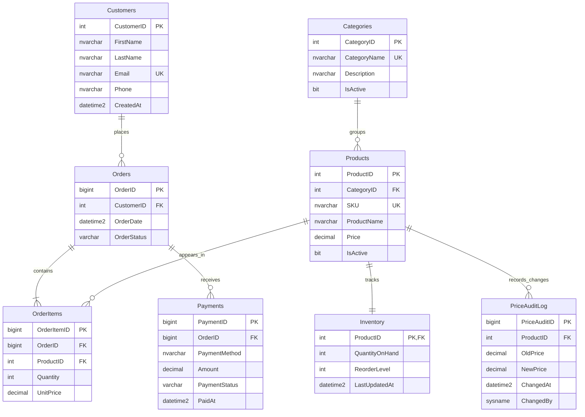

# Entity Relationship Diagram

The diagram shows the project tables and their one-to-many relationships. `Inventory` is one-to-one with `Products`; a product can have many order lines and price audit entries. An order can have multiple payment attempts.

`UK` labels a unique key. `OrderItems.UnitPrice` is the checkout-time price, not a copy of the current catalog price; it preserves transaction history when `Products.Price` changes.
